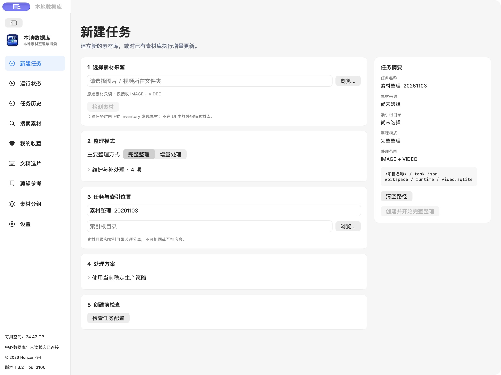
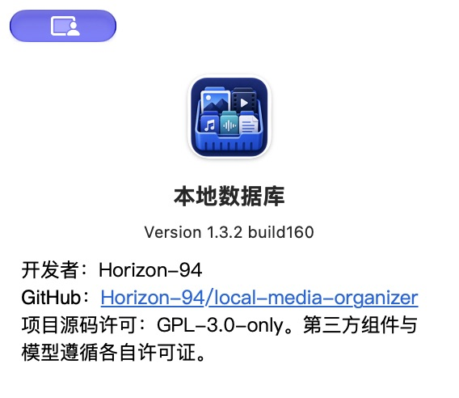

# 本地数据库（Local Media Organizer）

面向 Apple Silicon macOS 的本地素材整理与搜索软件。图片、视频、索引和模型由用户保存在本机。

**当前维护源码版本：1.3.2 build160。** 本次更新的是经过本地正式 App 验收的源码、测试和文档，**没有发布 BUILD160 DMG、安装包或 GitHub Release**。已有 [1.2.7 发行记录](docs/releases/1.2.7.md) 保留，不代表 BUILD160 安装包已可下载。

## 当前功能

- 整理图片与视频，生成本地预览、抽帧和 SQLite 索引，原素材只读。
- 画面内容、对白与文字、综合搜索三种模式；区分直接画面描述、扩展线索、对白原文与语义、OCR 和视觉向量证据。
- 搜索当前库、多个库或全部可用库；不可用库单独说明，不影响其余库。历史验收与测试库默认折叠隐藏，可主动查看。
- 根据已有转写整理**疑似采访／问答**及长口播／长对话，展示摘句、时间范围和判断依据，不虚构生成式摘要或说话人身份。
- 按页浏览有转写的视频，查看单视频原文和时间码，定位播放；人物范围取出镜视频与有效转写的交集，出镜不等于说话。
- 默认简体中文显示，英文保持原样，可查看原文。新任务明确采用中文转写和简体规范化策略，保留原始模型输出及时间码；不会重写历史转写。
- 查询取消、再次搜索、多命中时点预览以及正常退出时的资源回收。

完整变更、验证结果及限制见 [BUILD160 版本说明](docs/releases/1.3.2-build160.md) 和 [CHANGELOG](CHANGELOG.md)。

## 真实软件界面

以下截图来自实际运行的本地正式 BUILD160。为保护私人素材，只展示无素材路径、无人脸、无私人对白的页面；不以设计稿或旧版本截图代表新功能。

### 新建任务



### 关于软件



## 从源码验证与构建

需要 Apple Silicon Mac、Xcode 和 Python 3.10+。测试也在安装环境使用的系统 Python 3.9 上通过；公开开发基线保持 Python 3.10+。以下验证不下载模型、不读取用户素材、不创建业务索引：

```bash
python3 scripts/build160/check.py
python3 scripts/build160/build.py
```

也可在 Xcode 中打开 `macos/Build160.xcodeproj`，使用 `Build160Frontend` scheme 执行 Build / Analyze。默认产物位于 `build/DerivedData/Build/Products/Debug/Build160Frontend`。

该产物是原生前端可执行文件，供源码集成与验证使用，**不是可独立运行的完整 App**。完整运行还需要 Python helper、各模型独立环境、运行配置和用户提供的模型。此次没有重新打包这些运行环境，也没有提供新的安装包构建验收或公证承诺。请阅读 [BUILD160 源码构建说明](docs/BUILD160_SOURCE_BUILD.md)。历史 `build_native_*` 打包脚本保留用于历史版本追溯，不作为 BUILD160 的已验证安装包入口。

当前 Swift/Python 运行源码直接来自已验收的 BUILD160；[源码对应清单](docs/build160-source-manifest.json) 记录逐文件哈希。机器专属路径改为可移植默认值，本机历史任务迁移批准文件不公开、不泛化为对任意旧数据库的升级授权。

## 搜索与转写的边界

- 画面描述及文本语义可能存在模型误差；扩展关键词命中不证明物体真实出现在画面中。
- OpenCLIP 保留既有阈值；达不到阈值时不制造命中。中文查询与部分英文表达仍受现有模型能力限制。
- 简体规范化只处理中文书写形式，不纠正识别错字、不翻译英文，也不保证 Whisper 永不误识别语言。
- 采访识别采用规则，只标记“疑似”；长内容使用实际转写覆盖、连续片段和静默间隔，不能把首末跨度当作连续讲话。
- 文稿选片、人工标注写入等历史或实验入口，不因本次采访与搜索验收自动获得新的功能完成声明。

## 模型、隐私与许可

模型不在本仓库内。参见 [模型来源](MODEL_SOURCES.md)、[模型配置说明](docs/MODEL_SETUP.md)、[隐私说明](PRIVACY.md) 和 [第三方声明](NOTICE)。BUILD160 的实际模型配置以当前源码中的运行合同为准；旧安装版说明属于历史发行记录。

项目源码许可：**GPL-3.0-only**。第三方组件、模型和权重遵循各自许可证，不因本项目源码许可而重新授权。参见 [LICENSE](LICENSE)、[许可证历史](LICENSE_HISTORY.md)。

Copyright (C) 2026 [Horizon-94](https://github.com/Horizon-94)。官方仓库：[Horizon-94/local-media-organizer](https://github.com/Horizon-94/local-media-organizer)。
